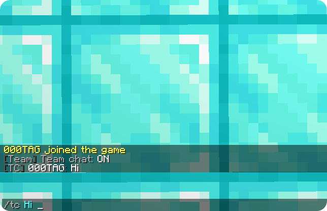

# VanillaTeams

A lightweight vanilla-friendly team plugin for Paper and Purpur servers. 

No `/team home`, no warps, and no virtual team chests. Just basic teams, team chat, alliances, and vote-based friendly fire.

---

## Supported server software

<table border="0" align="center" cellpadding="8">
  <tr align="center">
    <td></td>
    <td></td>
    <td></td>
  </tr>
  <tr align="center" valign="top">
    <td><b>Paper</b></td>
    <td><b>Purpur</b></td>
    <td><b>Spigot</b></td>
  </tr>
</table>

 

---

## Features

<strong>Vanilla-friendly gameplay</strong>

Keeps survival simple and fair. No team homes, teleport commands, warps, or virtual team storage.

<strong>Friendly fire voting</strong>

Friendly fire is enabled by default. Any team member can start a vote using `/team pvp on` or `/team pvp off`. Online members can vote using clickable **[Yes]** and **[No]** buttons.

<strong>Friendly fire protection</strong>

Team damage is handled at the lowest event priority, allowing VanillaTeams to cancel friendly fire before other plugins process the damage event.

<strong>Private team and ally chat</strong>

- `/tc <message>` — Send a private team message.
- `/tc` — Toggle team chat mode.
- `/ac <message>` — Send a private ally message.
- `/ac` — Toggle ally chat mode.

<strong>DiscordSRV support</strong>

Team and ally messages stay private and are not sent to public DiscordSRV channels.

<strong>Team alliances</strong>

Each team can have one allied team. Send an alliance request using `/team ally <team>` and accept or deny it using clickable buttons.

<strong>SQLite database</strong>

Teams, leaders, members, and usernames are saved automatically in `database.db`, preserving team data across server restarts.

---

## Commands

<strong>Team Management</strong>

### Create a team
`/team create <name>`

Creates a new team.

  
  

> **Permission:** `vanillateams.use`

### Invite a player
`/team invite <player>`

Sends an invitation to a player to join your team.

  
  

> **Permission:** `vanillateams.use`

### Accept or decline an invitation
- `/team accept <team>` — Accept an invitation.
- `/team deny <team>` — Decline an invitation.

  
  

  
  

> **Permission:** `vanillateams.use`

### Leave a team
`/team leave`

Leaves your current team.

  
  

> **Permission:** `vanillateams.use`

### Kick a member
`/team kick <player>`

Removes a member from your team. Team leaders only.

  
  

> **Permission:** `vanillateams.use`

### Transfer leadership
`/team transfer <player>` *(or `/team leader <player>`)*

Transfers leadership to another team member.

  
  

> **Permission:** `vanillateams.use`

### View team information
`/team info [team]`

Displays team information and its members.

  

> **Permission:** `vanillateams.use`

### Disband a team
`/team disband`

Disbands your team. Team leaders only.

  
  

> **Permission:** `vanillateams.use`

### List all teams
`/teams`

Lists all teams on the server.

> **Permission:** `vanillateams.use`

<strong>Friendly Fire Voting</strong>

### Start a vote
- `/team pvp on` — Propose enabling friendly fire.
- `/team pvp off` — Propose disabling friendly fire.

Starts a vote to change friendly fire settings for your team.

  

> **Permission:** `vanillateams.use`

### Cast your vote
- `/team pvp yes` — Vote yes.
- `/team pvp no` — Vote no.

Casts your vote on an active friendly fire proposal.

> **Permission:** `vanillateams.use`

<strong>Team and Ally Chat</strong>

### Team chat
- `/tc <message>` — Send a message to your team.
- `/tc` — Toggle team chat mode.

  
  

  

> **Permission:** `vanillateams.use`

### Ally chat
- `/ac <message>` — Send a message to your allied team.
- `/ac` — Toggle ally chat mode.

  

> **Permission:** `vanillateams.use`

<strong>Alliances</strong>

### Request an alliance
`/team ally <team>` *(or `/ally <team>`)*

Sends an alliance request to another team.

  

> **Permission:** `vanillateams.use`

### Accept or decline an alliance
- `/team ally accept` *(or `/ally accept`)* — Accept an incoming alliance request.
- `/team ally deny` *(or `/ally deny`)* — Decline an incoming alliance request.

> **Permission:** `vanillateams.use`

### Break an alliance
`/team ally break` *(or `/ally break`)*

Ends your current alliance.

  

> **Permission:** `vanillateams.use`

<strong>Administration</strong>

### Force-disband a team
`/team disband <team>`

Force-disbands a team.

> **Permission:** `vanillateams.admin`

### Reload configuration
`/team reload`

Reloads the plugin configuration.

> **Permission:** `vanillateams.admin`

---

## Requirements

- Paper / Purpur 1.21.4+ (or Paper 26.x)
- Java 21+ (Java 25 if running 26.1+)
