# VanillaTeams

A lightweight vanilla-friendly team plugin for Paper and Purpur servers. 

No `/team home`, no warps, and no virtual team chests. Just basic teams, team chat, alliances, and vote-based friendly fire.

---

## Supported server software

<table border="0" align="center" cellpadding="8">
  <tr align="center">
    <td></td>
    <td></td>
    <td></td>
  </tr>
  <tr align="center" valign="top">
    <td><sub><b>Paper</b></sub></td>
    <td><sub><b>Purpur</b></sub></td>
    <td><sub><b>Spigot</b></sub></td>
  </tr>
</table>

<br>

---

## Features

<details>
<summary><strong>Vanilla-friendly gameplay</strong></summary>

Keeps survival simple and fair. No team homes, teleport commands, warps, or virtual team storage.

</details>

<details>
<summary><strong>Friendly fire voting</strong></summary>

Friendly fire is enabled by default. Any team member can start a vote using `/team pvp on` or `/team pvp off`. Online members can vote using clickable **[Yes]** and **[No]** buttons.

</details>

<details>
<summary><strong>Friendly fire protection</strong></summary>

Team damage is handled at the lowest event priority, allowing VanillaTeams to cancel friendly fire before other plugins process the damage event.

</details>

<details>
<summary><strong>Private team and ally chat</strong></summary>

- `/tc <message>` — Send a private team message.
- `/tc` — Toggle team chat mode.
- `/ac <message>` — Send a private ally message.
- `/ac` — Toggle ally chat mode.

</details>

<details>
<summary><strong>DiscordSRV support</strong></summary>

Team and ally messages stay private and are not sent to public DiscordSRV channels.

</details>

<details>
<summary><strong>Team alliances</strong></summary>

Each team can have one allied team. Send an alliance request using `/team ally <team>` and accept or deny it using clickable buttons.

</details>

<details>
<summary><strong>SQLite database</strong></summary>

Teams, leaders, members, and usernames are saved automatically in `database.db`, preserving team data across server restarts.

</details>

---

## Configuration

<details open>
<summary><strong>Settings</strong></summary>
<br>

```yaml
settings:
  min-name-length: 2
  max-name-length: 16
  max-members: 10
  invite-expire-seconds: 60
  ally-request-expire-seconds: 60
  default-team-pvp: true
  pvp-vote-timeout-seconds: 30
```

</details>

<details>
<summary><strong>Messages</strong></summary>
<br>

```yaml
messages:
  prefix: "&8[&7Team&8] "
  ally-prefix: "&8[&7Ally&8] "
  chat-format: "&8[&7TC&8] &f<player>&8: &7<message>"
  ally-chat-format: "&8[&7AC&8] &8[&7<team>&8] &f<player>&8: &7<message>"

  player-only: "&7This command is for players only."
  no-permission: "&7You don't have permission to do that."
  reloaded: "&7Config reloaded."

  team-created: "&7Created &f<team>&7."
  team-disbanded: "&f<team> &7has been disbanded."
  already-in-team: "&7You're already in a team."
  not-in-team: "&7You're not in a team."
  not-leader: "&7Only the leader can do that."
  team-exists: "&f<team> &7already exists."
  team-not-found: "&7Couldn't find team &f<team>&7."
  invalid-name: "&7Name must be &f<min>-<max> &7characters (letters, numbers, underscores)."
  team-full: "&7Team is full (&f<max>&7)."

  invite-sent: "&7Invited &f<player>&7."
  invite-received: "&7You've been invited to &f<team>&7. "
  already-invited: "&f<player> &7already has a pending invite."
  target-in-team: "&f<player> &7is already in a team."
  player-not-found: "&f<player> &7is not online."
  no-pending-invite: "&7You don't have a pending invite."
  invite-denied: "&7Denied the invite from &f<team>&7."
  invite-denied-notify: "&f<player> &7declined your invite."
  member-joined: "&f<player> &7joined."
  member-left: "&f<player> &7left."
  leader-cannot-leave: "&7Transfer leadership first (&f/team transfer <player>&7) or &f/team disband&7."
  member-kicked: "&f<player> &7was kicked."
  kicked-notify: "&7You were kicked from &f<team>&7."
  not-in-your-team: "&f<player> &7isn't in your team."
  cannot-kick-self: "&7You can't kick yourself."
  leader-transferred: "&f<player> &7is the new leader."

  pvp-status: "&7Team PvP: &f<state>"
  pvp-changed: "&7Team PvP is now <state>&7."
  pvp-vote-started: "&f<player> &7wants to set Team PvP to <state>&7. "
  pvp-vote-cast: "&f<player> &7voted <vote>&7."
  pvp-vote-passed: "&7Vote passed &8(&f<yes> &7yes, &f<no> &7no&8)&7. Team PvP is now <state>&7."
  pvp-vote-failed: "&7Vote didn't pass &8(&f<yes> &7yes, &f<no> &7no&8)&7. Team PvP stays <state>&7."
  pvp-vote-already-active: "&7There's already a vote going on."
  pvp-already-voted: "&7You already voted."
  pvp-no-active-vote: "&7No vote is happening right now."
  pvp-not-eligible: "&7You can't vote on this."
  pvp-already-set: "&7Team PvP is already <state>&7."
  friendly-fire-blocked: "&7Friendly fire is off."

  chat-toggled-on: "&7Team chat: &fON"
  chat-toggled-off: "&7Team chat: &fOFF"
  ally-chat-toggled-on: "&7Ally chat: &fON"
  ally-chat-toggled-off: "&7Ally chat: &fOFF"

  ally-request-sent: "&7Sent ally request to &f<team>&7."
  ally-request-received: "&f<team> &7wants to ally. "
  ally-accepted: "&7Now allied with &f<team>&7."
  ally-denied: "&7Denied ally request from &f<team>&7."
  ally-denied-notify: "&f<team> &7turned down your ally request."
  ally-broken: "&7Alliance with &f<team> &7is over."
  already-have-ally: "&7You already have an ally (&f<ally>&7)."
  target-has-ally: "&f<team> &7already has an ally."
  no-ally: "&7Your team doesn't have an ally."
  no-ally-request: "&7No pending ally request."
  cannot-ally-self: "&7You can't ally with your own team."
```

</details>

---

## Commands

<details>
<summary><strong>Commands and Previews</strong></summary>
<br>

| Command | Description | Preview *(Click to zoom)* |
|:---|:---|:---:|
| `/team create <name>` | Create a new team | [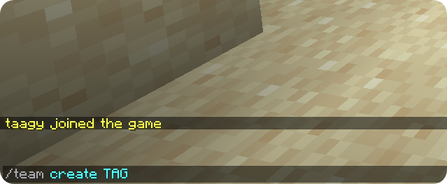](assets/images/TeamCreate1.png) [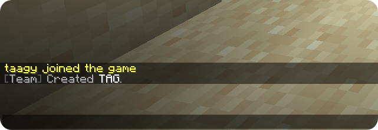](assets/images/TeamCreate2.png) |
| `/team invite <player>` | Send invite to an online player *(Leader only)* | [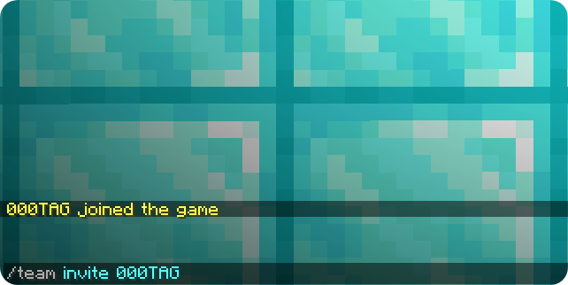](assets/images/TeamInvite1.png) [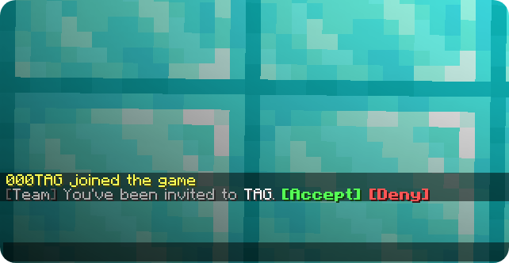](assets/images/TeamInvite2-P2.png) |
| `/team accept [team]` | Accept pending team invitation | [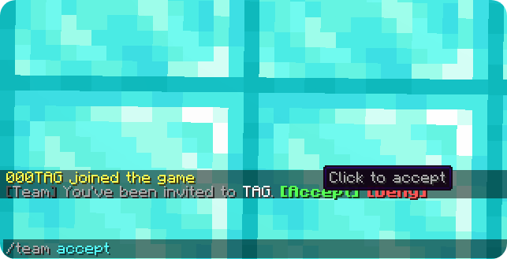](assets/images/TeamAccept-P2.png) [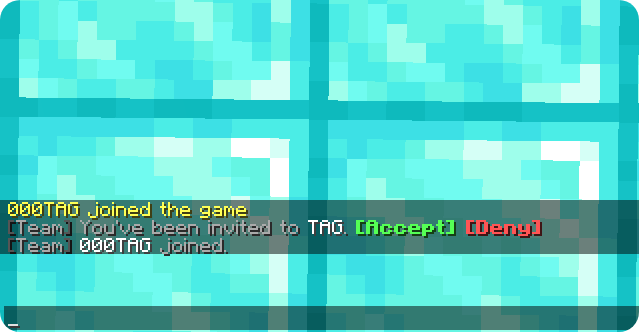](assets/images/TeamAccept2-P2.png) |
| `/team deny [team]` | Decline pending team invitation | [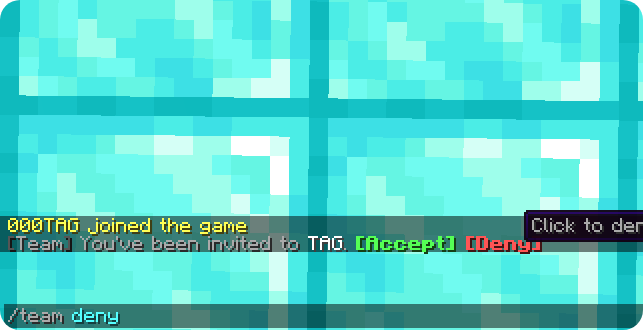](assets/images/TeamDeny1-P2.png) [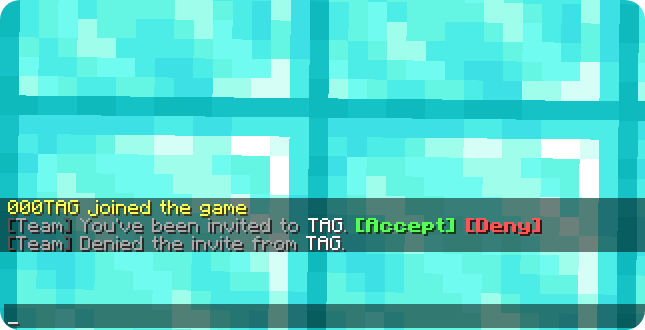](assets/images/Teamdeny2-P2.png) |
| `/team leave` | Leave your current team | [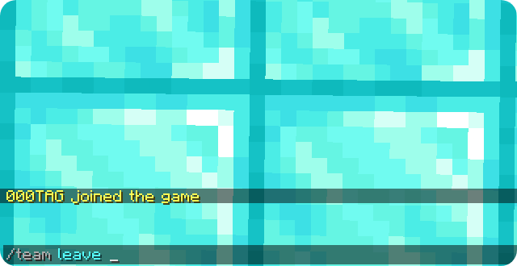](assets/images/TeamLeave1-P2.png) [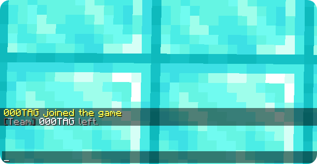](assets/images/TeamLeave2-P2.png) |
| `/team kick <player>` | Remove a member from your team *(Leader only)* | [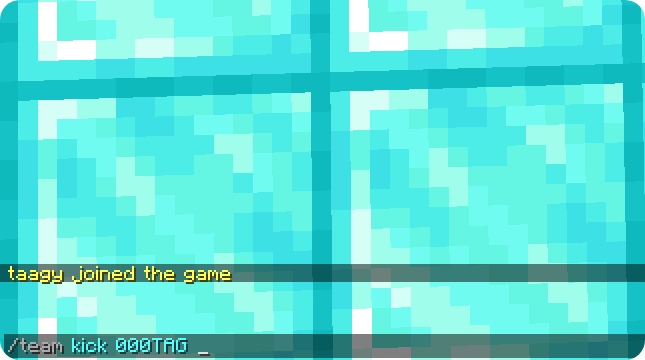](assets/images/TeamKick-P1.png) [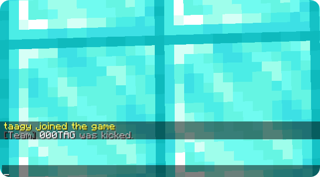](assets/images/TeamKick2-P1.png) |
| `/team transfer <player>`<br><sub>*(or `/team leader`)*</sub> | Transfer team leadership *(Leader only)* | [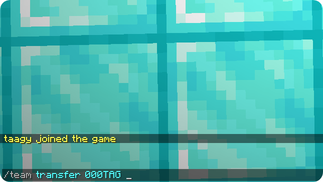](assets/images/TeamTransfer1-P1.png) [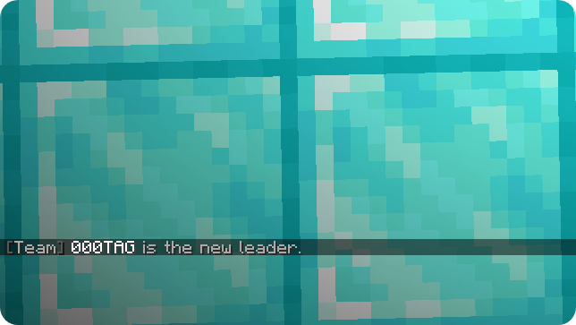](assets/images/TeamTransfer2-P1.png) |
| `/team info [team]` | View team details and member list | [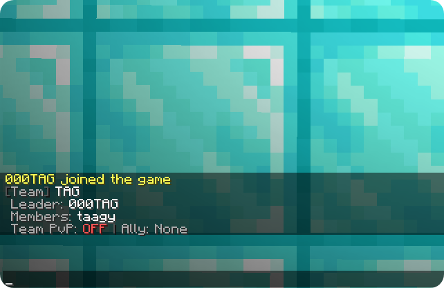](assets/images/TeamInfo.png) |
| `/team disband` | Disband your team completely *(Leader only)* | [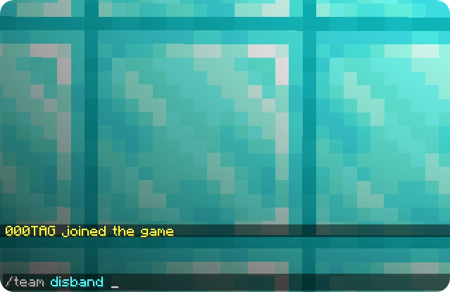](assets/images/TeamDisband1.png) [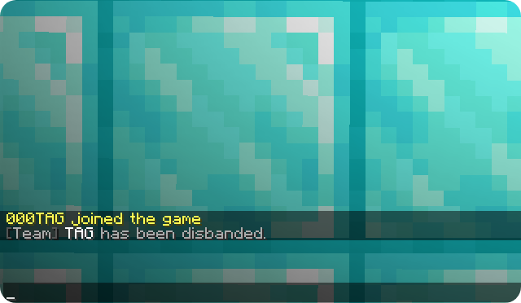](assets/images/TeamDisband2.png) |
| `/teams` | List all teams on the server | — |
| `/team pvp [on\|off]` | Start a vote to enable or disable friendly fire | [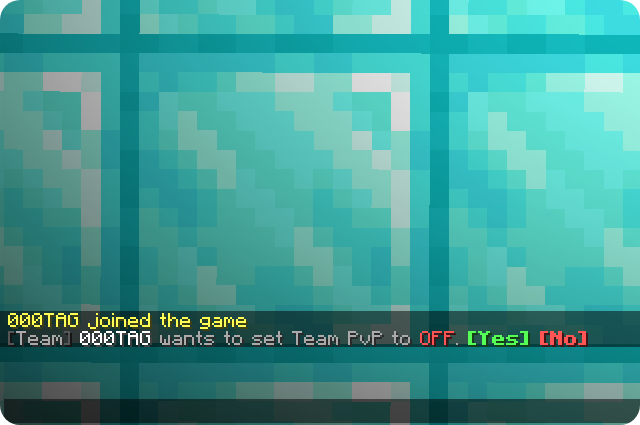](assets/images/TeamVoting1.png) |
| `/team pvp [yes\|no]` | Cast your vote on an active friendly fire proposal | — |
| `/tc [message]` | Send team message or toggle team chat mode | [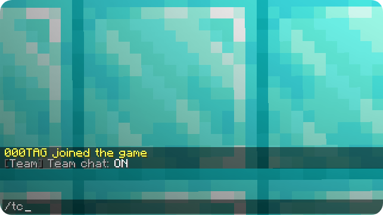](assets/images/TeamTc.png) [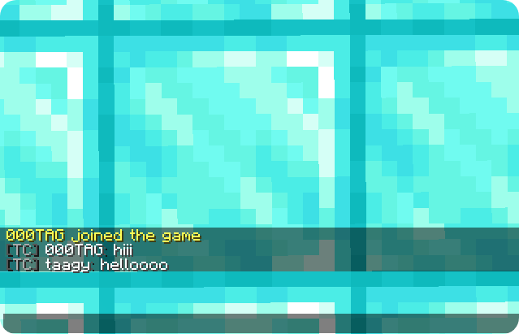](assets/images/TeamMessage.png) |
| `/ac [message]` | Send ally message or toggle ally chat mode | [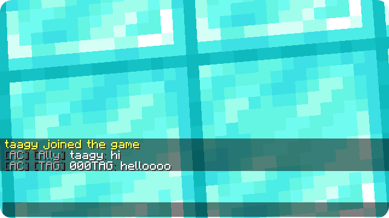](assets/images/AllyChat.png) |
| `/team ally <team>`<br><sub>*(or `/ally <team>`)*</sub> | Send alliance request to another team *(Leader only)* | [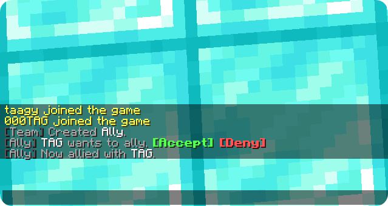](assets/images/TeamAllyAccept.png) |
| `/team ally accept\|deny` | Respond to an incoming alliance request *(Leader only)* | — |
| `/team ally break` | Break your current team alliance *(Leader only)* | [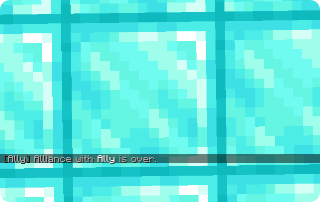](assets/images/TeamAllyBreak.png) |
| `/team disband <team>` | Force-disband any team *(Admin only)* | — |
| `/team reload` | Reload configuration *(Admin only)* | — |

</details>

---

## Requirements

- Paper / Purpur 1.21.4+ (or Paper 26.x)
- Java 21+ (Java 25 if running 26.1+)

<p align="center">
  <a href="https://ko-fi.com/I6C527B4XK" target="_blank">
    
  </a>
</p>
